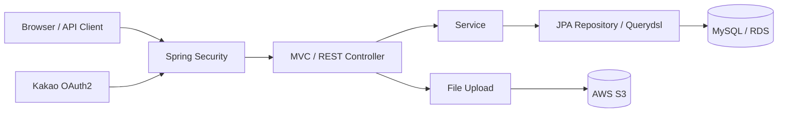

# Servlet2Spring

Servlet/JSP로 시작한 웹 애플리케이션을 Spring MVC와 Spring Boot로 단계적으로 전환하고 AWS 환경에 배포한 프로젝트입니다.

요청 처리·의존성 관리·데이터 접근·인증 구조가 프레임워크 전환 과정에서 어떻게 달라지는지 직접 비교하며 마이그레이션을 진행했습니다. 초기 Servlet/JSP 코드와 Spring MVC 설정을 함께 보존해 각 단계의 차이를 확인할 수 있으며, 최종적으로 게시판과 회원 기능을 갖춘 Spring Boot 애플리케이션을 완성했습니다.

## 마이그레이션 과정

| 단계 | 요청 처리 | 데이터 접근 | 인증·실행 환경 |
| --- | --- | --- | --- |
| Servlet/JSP | 요청별 Servlet, Filter, Listener, JSP | JDBC, DAO, HikariCP | Session/Cookie, 외장 Tomcat |
| Spring MVC | DispatcherServlet, Annotation Controller, DI, Validation | MyBatis Mapper/XML | XML·Java Config, PRG, ControllerAdvice |
| Spring Boot | 내장 Tomcat, Thymeleaf, REST Controller | Spring Data JPA, Querydsl | Spring Security, OAuth2, JWT, AWS |

저장소에는 전환 과정을 비교할 수 있도록 `examples`, 기존 JSP/XML 설정, MyBatis 기반 Todo 기능과 최종 JPA 기반 게시판 기능이 함께 남아 있습니다. 이를 통해 각 단계에서 요청 처리와 데이터 접근 구조가 변화한 과정을 확인할 수 있습니다.

## 주요 기능

- 게시글 CRUD, 유효성 검증, 검색 및 페이징
- 게시글별 댓글 CRUD와 댓글 수 집계
- 다중 이미지 첨부, S3 업로드·조회·삭제, Presigned URL 생성
- 회원가입과 BCrypt 비밀번호 암호화
- Spring Security 기반 로그인, 역할 및 작성자 권한 검사, Remember-me
- 카카오 OAuth2 소셜 로그인
- JWT 생성 및 검증 예제
- SpringDoc OpenAPI를 이용한 댓글·파일 API 문서화
- JPA Auditing을 이용한 등록일·수정일 관리

## 시스템 아키텍처



```text
src/main/java/org/servlet2spring
├── examples/                 # Servlet, Spring MVC, Spring Boot 단계별 예제
└── todo/
    ├── config/               # MVC, Security, Swagger, AWS 설정
    ├── controller/           # 화면 및 REST 요청 처리
    ├── domain/               # JPA Entity
    ├── dto/                  # 계층 간 데이터 전달
    ├── mapper/               # MyBatis 기반 Todo 단계
    ├── repository/           # Spring Data JPA, Querydsl
    ├── security/             # Form Login, OAuth2 사용자 처리
    ├── service/              # 비즈니스 로직과 트랜잭션 경계
    └── util/                 # JWT, 로컬/S3 파일 처리
```

## 기술 스택

| 영역 | 기술 |
| --- | --- |
| Language | Java 21 |
| Framework | Spring Boot 3.2.6, Spring MVC, Spring Security |
| View | JSP/JSTL, Thymeleaf, Bootstrap |
| Data | JDBC, HikariCP, MyBatis, Spring Data JPA, Querydsl, MySQL |
| Auth | Form Login, Remember-me, OAuth2 Client, JWT, BCrypt |
| Infra | Embedded Tomcat, AWS EC2, RDS, S3 |
| Test/Build | JUnit 5, Spring Boot Test, Maven |
| Logging/API | Log4j2, SpringDoc OpenAPI |

## 실행 방법

### 사전 준비

- JDK 21
- MySQL
- Kakao OAuth2 애플리케이션
- AWS S3 버킷 및 접근 권한

### 환경 설정

실행 전 `src/main/resources/application.properties`에 다음 설정이 필요합니다. 실제 자격 증명은 저장소에 커밋하지 말고 환경변수 또는 별도의 로컬 설정 파일로 관리하는 것을 권장합니다.

| 구분 | 필요한 설정 |
| --- | --- |
| Database | `spring.datasource.url`, `username`, `password` |
| Upload | `spring.servlet.multipart.location`, `org.servlet2spring.upload.path` |
| JWT | `org.org.servlet2spring.jwt.secret` |
| Kakao OAuth2 | Client ID, Client Secret, Redirect URI |
| AWS | Region, S3 Bucket, Credentials |

### 애플리케이션 실행

```bash
./mvnw spring-boot:run
```

기본 진입 경로는 다음과 같습니다.

- 게시글 목록: `http://localhost:8080/board/list`
- 회원가입: `http://localhost:8080/member/join`
- 로그인: `http://localhost:8080/member/login`
- Swagger UI: `http://localhost:8080/swagger-ui/index.html`

포트는 `application.properties`의 `server.port` 설정에 따라 달라질 수 있습니다.

## 테스트

```bash
./mvnw test
```

Repository·Service·JWT·S3 등 단계별 테스트 코드가 포함되어 있습니다. MySQL과 AWS 연동 테스트를 실행하려면 애플리케이션과 동일한 외부 환경 설정이 필요합니다.

## 회고

이 프로젝트를 통해 프레임워크가 제공하는 편리함뿐 아니라 그 이전 단계에서 직접 관리해야 했던 요청 처리, 객체 생명주기, 데이터베이스 연결과 인증 흐름을 함께 이해할 수 있었습니다. 또한 새로운 기술을 적용하는 것보다 기존 동작을 파악하고 변경의 영향을 통제하는 일이 먼저라는 점을 배웠습니다. 이러한 경험을 바탕으로 Servlet/JSP 애플리케이션을 Spring Boot 기반 구조로 전환하고, 인증·파일 처리·AWS 배포까지 이어지는 전체 개발 과정을 완료했습니다.
